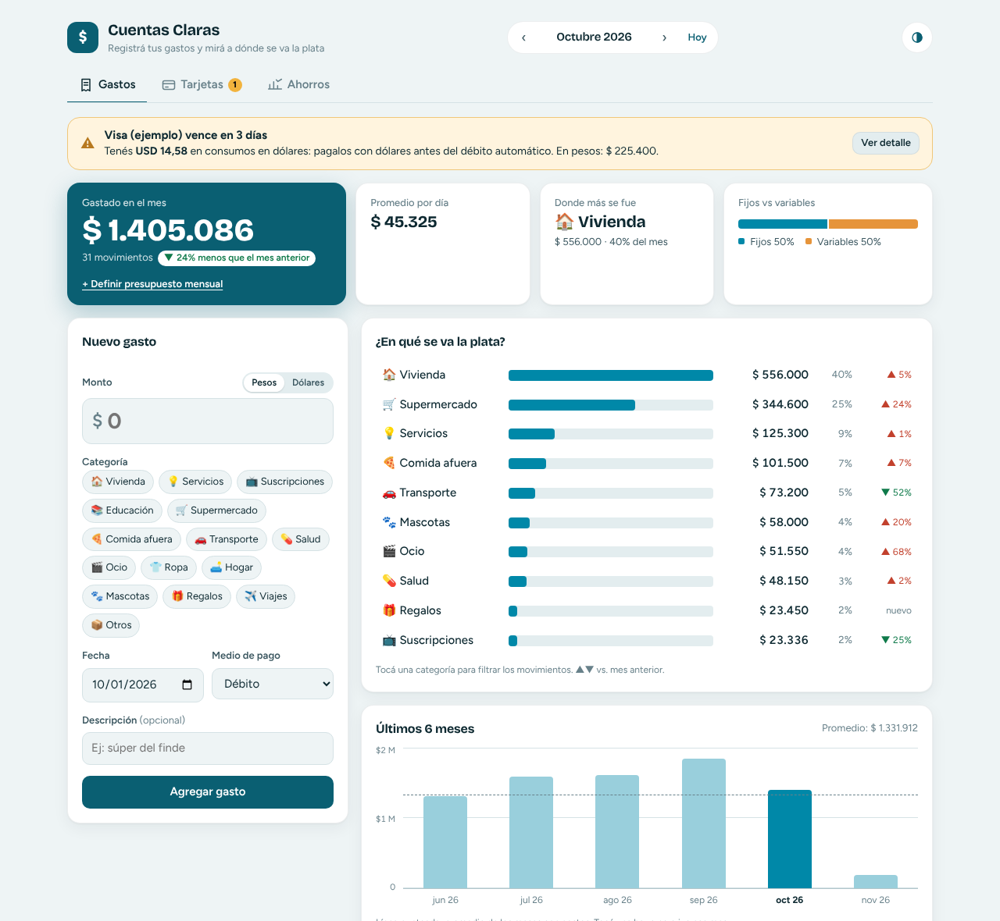
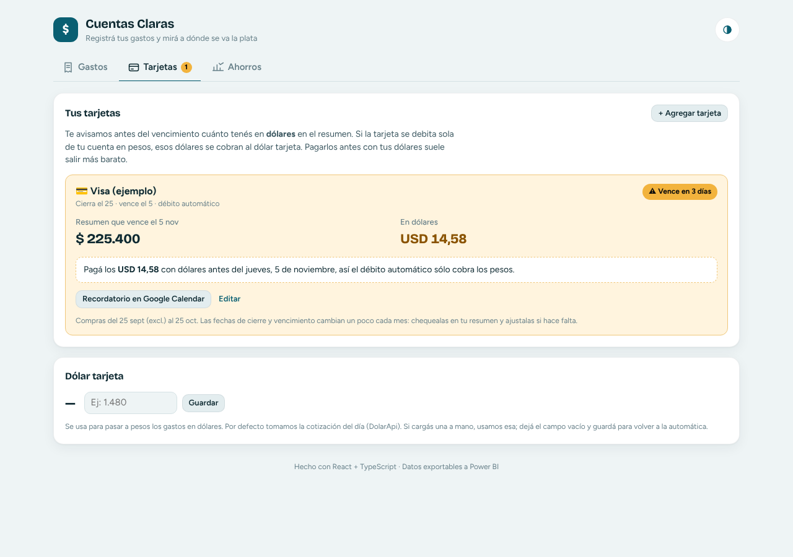
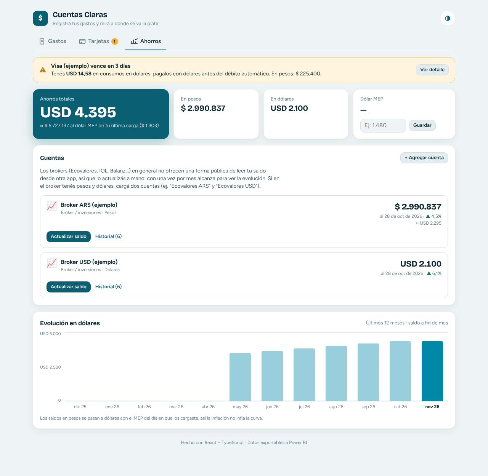
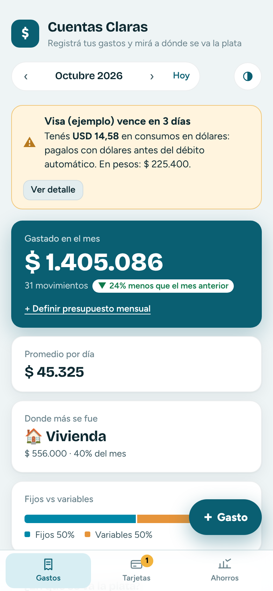
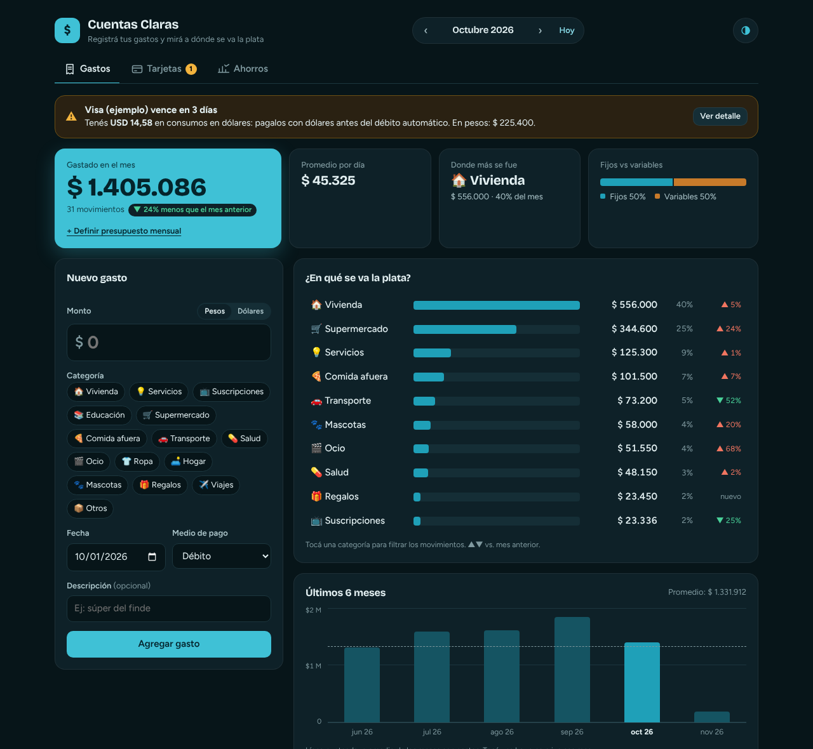

# 💸 Cuentas Claras

App web para **registrar gastos mensuales y ver en qué categoría se va la plata**, con login de Google, avisos de vencimiento de tarjetas, seguimiento de ahorros y datos listos para **Power BI**.



<p align="center">
  
  
</p>
<p align="center">
  
  
</p>

**[Demo en vivo](#)** · [Reporte de Power BI](powerbi/README.md)

## Qué hace

**Cuenta y sincronización**
- Login con **Google** (Supabase Auth). Los datos quedan en Postgres y se ven desde cualquier navegador o el celu.
- Row Level Security: cada usuario lee y escribe sólo sus filas.
- Modo invitado sin cuenta; al iniciar sesión ofrece subir lo cargado en el navegador.

**Tarjetas de crédito**
- Cargás cierre, vencimiento y si tiene débito automático.
- Calcula qué compras entran en el resumen y cuánto hay **en dólares**.
- Avisa X días antes del vencimiento: "pagá los USD antes del débito automático".
- Crea un recordatorio mensual en Google Calendar.

**Ahorros**
- Cuentas en brokers, bancos o billeteras, en pesos o dólares.
- Total valuado en USD y en pesos al dólar MEP del día (DolarApi), con evolución mensual.

**Gastos**

- **Carga rápida**: monto en pesos o dólares (acepta `12.500,50`), categoría con un toque, fecha, medio de pago y tarjeta.
- **Resumen del mes**: total, variación vs. mes anterior, promedio diario (hasta hoy en el mes en curso), categoría principal y split fijos/variables.
- **Ranking por categoría** con % del total y variación por categoría. Tocar una categoría filtra los movimientos.
- **Tendencia de 6 meses** con línea de promedio; tocar una barra navega a ese mes.
- **Presupuesto mensual** con medidor (ok / cerca / te pasaste).
- Editar, buscar y filtrar movimientos.
- **Exportar para Power BI** (`gastos.csv` + `categorias.csv`), backup/restore en JSON y datos de ejemplo.
- **Pensada para el celu**: navegación abajo, botón "+ Gasto" a mano y formulario en hoja deslizable.
- Borrar sin confirmaciones molestas, con **Deshacer**.
- Paleta propia (azul petróleo con acento cálido) con modo claro, oscuro o automático.

## Stack

| | |
|---|---|
| Front | React 19 + TypeScript (strict) + Vite |
| Estilos | CSS puro con design tokens claro/oscuro, fuentes variables autoalojadas (Bricolage Grotesque + Figtree) |
| Gráficos | Componentes propios en HTML/CSS (sin dependencias) |
| Datos y login | Supabase (Postgres + Auth con Google + RLS), o `localStorage` en modo local, detrás de una interfaz de repositorio |
| Cotizaciones | [DolarApi](https://dolarapi.com) (dólar tarjeta y MEP), con carga manual de respaldo |
| BI | Power Query (M) + DAX + tema propio → [`powerbi/`](powerbi/README.md) |
| Calidad | `tsc` strict + oxlint |

## Arquitectura

```
src/
├── types.ts                 # Modelo de dominio (Expense, Category, ...)
├── Root.tsx                 # Elige modo: local, invitado o nube (según login)
├── data/
│   ├── repository.ts        # Interfaz ExpenseRepository + implementación localStorage
│   └── supabaseRepository.ts# Implementación Postgres/Supabase
├── hooks/                   # useExpenses (estado + CRUD), useAuth (sesión de Google)
├── lib/
│   ├── stats.ts             # Agregaciones: totales por categoría/mes, resumen, variaciones
│   ├── cards.ts             # Ciclo de resumen (cierre/vencimiento), USD del resumen, link a Calendar
│   ├── savings.ts           # Saldos, valuación en USD con el MEP de cada carga, evolución
│   ├── rates.ts             # Cotizaciones desde DolarApi
│   ├── csv.ts               # Export en modelo estrella para Power BI
│   ├── format.ts            # Formato ARS y parseo de montos en formato argentino
│   ├── dates.ts / demo.ts   # Utilidades de fecha y generador de datos de ejemplo
│   └── categories.ts
└── components/              # Login, Gastos (KPIs, ranking, tendencia), Tarjetas, Ahorros
supabase/schema.sql          # Tablas, políticas RLS y vistas para Power BI
```

Decisiones:

- **Repositorio como interfaz**: la UI no sabe dónde se guardan los datos; `localStorage` y Supabase implementan la misma interfaz.
- **Seguridad en la base, no en el front**: la clave pública de Supabase va en el cliente; RLS garantiza que nadie lea datos ajenos.
- **Ahorros valuados con el MEP del día de cada carga**: la evolución en USD no se distorsiona por la inflación.
- **Lógica pura separada de React** (`lib/stats.ts`): las agregaciones son funciones puras, fáciles de testear y reutilizar.
- **Ranking horizontal en lugar de torta**: compara magnitudes mejor y entran 15 categorías sin necesitar 15 colores.
- **CSV pensado para BI**: hechos + dimensión, fechas ISO y punto decimal para que Power Query no dependa de la configuración regional.

## Correr localmente

Sin configurar nada corre en **modo local**. Para el login con Google seguí [`docs/setup.md`](docs/setup.md) (Supabase + Google Cloud + Vercel, ~20 min).

```bash
cp .env.example .env.local   # opcional: datos de Supabase
npm install
npm run dev            # http://localhost:5173
npm run build          # build de producción en dist/
npm run build:demo     # un solo index.html autocontenido en dist-demo/
npm run sample:powerbi # regenera powerbi/sample-data/*.csv
```

## Deploy

Importá el repo en [Vercel](https://vercel.com/new): detecta Vite solo. Cargá `VITE_SUPABASE_URL` y `VITE_SUPABASE_ANON_KEY` en las variables de entorno (detalle en [`docs/setup.md`](docs/setup.md)).

## Power BI

Con Supabase, Power BI se conecta directo a Postgres (vistas `bi_gastos` y `bi_ahorros`, ver [`docs/setup.md`](docs/setup.md), paso 6). Sin Supabase, usá el export a CSV.

En [`powerbi/`](powerbi/README.md): consultas de Power Query, tabla calendario, medidas DAX (variación vs. mes anterior, YTD, promedio 12 meses, % fijos, ranking), diseño de 3 páginas, tema con la paleta de la app y datos de ejemplo de 12 meses.

## Próximos pasos

- [x] Login con Google + base en Supabase
- [x] Avisos de vencimiento de tarjetas con consumos en USD
- [x] Seguimiento de ahorros en ARS/USD
- [ ] Avisos por mail aunque no abras la app (Supabase Edge Function + cron)
- [ ] Categorías personalizables
- [ ] Gastos recurrentes (alquiler, servicios) que se cargan solos cada mes
- [ ] Tests de `lib/` con Vitest
- [ ] PWA instalable en el celular

---

Hecho por **Lucía Miloro** — [LinkedIn](#) · [GitHub](#)
